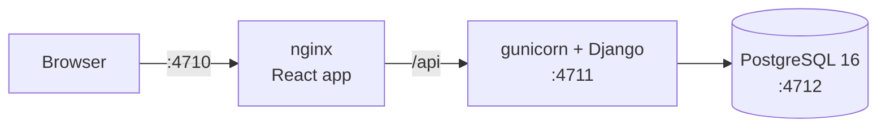

<div align="center">

# Ten Mission

**Book and cancel places on limited experiences, and never sell the same place twice.**

[](https://github.com/ashishkr619/ten-mission/actions/workflows/ci.yml)


[Quick start](#quick-start) · [How double booking is prevented](#how-double-booking-is-prevented) · [API](#api) · [Decisions](#decisions-and-assumptions) · [What's next](#whats-next)

</div>

---

## Quick start

You need Docker with Compose.

```bash
docker compose up --build
```

Then open **http://localhost:4710**.

| Service  | Address                 |
|----------|-------------------------|
| Website  | http://localhost:4710   |
| API      | http://localhost:4711   |
| Postgres | localhost:4712          |

The first start creates the tables and loads `data/members.csv` and `data/inventory.csv`; later starts keep the data. To start again from the CSV files, run `docker compose down -v`. The ports are unusual on purpose, so they don't clash with other projects; change them in `.env` (see `.env.example`).

### Run the tests

```bash
docker compose run --rm backend python manage.py test bookings
```

**61 tests** cover the booking rules, the API and the CSV loader. **7 of them fire real parallel requests at Postgres.** GitHub Actions runs them, and the frontend build, on every push.

---

## What it does

| Page | What you can do |
|---|---|
| **Inventory** | See every experience with the places left. Filter by open, fully booked or expired, and search by title. |
| **Book** | Pick a member and an experience, then book. The confirmation shows the booking reference. The member's active bookings are listed below and can be cancelled (two clicks, so nobody cancels by accident). |



---

## How double booking is prevented

All the rules are in [`bookings/services.py`](bookings/services.py), written with the Django ORM.

```text
POST /book {member_id, item_id}
  1. Check the input                        -> 422 if invalid
  2. Same Idempotency-Key used before?      -> return that booking (200)
  3. Item exists and has not expired?       -> item_not_found / item_expired
  4. In one transaction:
       member count +1, only if below 2     -> member_not_found / booking_limit_reached
       item stock   -1, only if above 0     -> sold_out (this also undoes the +1)
       save the booking                     -> 201 with the reference
  5. Lost a race to an identical request?   -> return the winner's booking (200)
```

- **Taking a place is one conditional `UPDATE`.** `remaining_count = remaining_count - 1 WHERE remaining_count > 0`, and the same for the member with `< 2`. Postgres checks the condition against the current row and makes a second request for that row wait. Two requests can never both take the last place, and there's no read-then-write in Python.
- **All or nothing.** The member, item and booking writes share one transaction.
- **A fixed order.** Booking and cancelling both update the member before the item, so they can never wait on each other in a circle.
- **The schema is a second line of defence.** Check constraints stop stock or a member's count going below zero. A unique rule on `(member, idempotency_key)` stops a retry from booking twice.
- **Checked by breaking it.** I removed each rule in turn (the stock check, the member limit, the expiry date, the transaction, cancel's once-only check, the retry lookups) and confirmed that a test fails every time.

> When several things are wrong at once, the error is always the first of: **item not found → item expired → member not found → booking limit → sold out**.

---

## Beyond the brief

The brief asks for the CSV loader, the models, `POST /book`, `POST /cancel`, two pages and a README. I went further where it matters most for this business:

- **Correctness under concurrency, proven by tests.** A double-booked place is the most expensive bug a booking business can have.
- **Safe retries.** A double click or a network retry never books twice.
- **Lists that load a page at a time, with search,** so both pages still work with thousands of members.
- **A considered design and copy.**
- **A load test,** described in [docs/performance.md](docs/performance.md).

---

## The data

The loader keeps every row and reports what it found:

| Finding | How it's handled |
|---|---|
| 45 members, 15 inventory items | All loaded |
| Two Sophie Davis, two Grace Miller | Different join dates, so different people and separate rows; the UI shows the join date |
| Two "London" items | Different stock and expiry; separate rows |
| 3 members already hold 3 bookings (limit is 2) | Loaded as they are; they can book again once below the limit |
| 3 items expired, 1 with no places left | Visible, but can't be booked |
| Any bad row | Never repaired silently: both files are checked first, and if anything is wrong, nothing is written |

---

## Decisions and assumptions

| Topic | Decision |
|---|---|
| **Limit** | At most 2 active bookings per member (`MAX_BOOKINGS` in `config/settings.py`) |
| **Expiry** | Bookable through the expiration date; "today" is the UTC date |
| **Same item twice** | Allowed, up to the limit; the brief doesn't forbid it |
| **CSV bookings** | `booking_count` becomes the starting count. Those bookings have no reference, so they count toward the limit but can't be cancelled |
| **Cancel** | Gives the place back exactly once. A repeat is safe and returns the booking unchanged. The row is kept (`cancelled_at`), so history isn't lost |
| **Retries** | An optional `Idempotency-Key` header makes a booking safe to repeat. The website sends one with every attempt and reuses it after a network failure |
| **No login** | Not asked for, so the client sends `member_id`. In production the member would come from the session |
| **Paths** | The API is under `/api/...`; `POST /book` and `POST /cancel` also work, as written in the brief |

---

## API

| Endpoint | Does | Success |
|---|---|---|
| `POST /api/book` | Body `{member_id, item_id}`, optional `Idempotency-Key` header | `201` new booking · `200` repeat of an earlier one |
| `POST /api/cancel` | Body `{member_id, reference}` | `200` the booking, also when already cancelled |
| `GET /api/inventory` | One page of items, open first; `total` and `counts` for the whole inventory | `200` |
| `GET /api/inventory/<id>` | One item | `200` |
| `GET /api/members` | One page of members by name, with `bookings_left`; `total` and `max_bookings` | `200` |
| `GET /api/members/<id>` | One member | `200` |
| `GET /api/members/<id>/bookings` | The member's active bookings, newest first | `200` |

Lists take `?limit=` (1–200, default 50), `?offset=` and `?q=` (search). The inventory also takes `?status=open|sold_out|expired`.

```bash
curl -X POST localhost:4711/api/book -H 'Content-Type: application/json' \
     -H 'Idempotency-Key: demo-1' -d '{"member_id": 1, "item_id": 1}'
```

```json
{
  "reference": "c6fdadd0-fb07-4e83-9f06-13ba42e20d7e",
  "member_id": 1,
  "item_id": 1,
  "item_title": "Bali",
  "booked_at": "2026-11-02T06:01:12.345678+00:00",
  "cancelled_at": null,
  "status": "active"
}
```

<details>
<summary><b>Errors</b>: every error has the same shape</summary>

```json
{"error": {"code": "sold_out", "message": "This item is sold out."}}
```

`fields` is added only for invalid input, and names every wrong field.

| Status | `code` | When |
|---|---|---|
| 400 | `invalid_json` | The body is not a JSON object |
| 422 | `invalid_request` | A field or parameter is missing or wrong |
| 404 | `member_not_found` · `item_not_found` · `booking_not_found` | It doesn't exist (someone else's booking is also "not found") |
| 409 | `item_expired` · `booking_limit_reached` · `sold_out` · `idempotency_key_conflict` | The rules say no |

</details>

---

## What this is not

Built with production in mind, but not a complete production system. Left out on purpose:

- login, permissions and rate limits
- metrics, structured logs and alerts
- sending confirmations (emails, notifications)
- a separate release step for migrations (the container runs them on start: fine for one container, not for several)
- a highly available database, and search indexes for very large lists

---

## What's next

**For the business**

1. **Waitlist:** offer a freed place to the next member in line.
2. **Short holds:** keep a place for a few minutes while a member decides.
3. **Fair access to the scarcest experiences:** a queue or a draw instead of "fastest click wins".
4. **A limit per membership tier,** instead of one `MAX_BOOKINGS` for everyone.
5. **An audit trail** for the concierge team: who booked or cancelled what, for whom.

**For scale**, in this order, and only as measurements call for each step. Bookings stay synchronous, and Postgres always decides who gets a place.

| # | Step | Why |
|---|---|---|
| 1 | **Production metrics and tracing** | The load test found this machine's limits; real traffic, on real servers, needs the same answers all the time |
| 2 | **Rate limits and bot protection**, per IP at the edge and per member in the app | The cheapest protection; on a popular release, bots and repeat clicks are much of the traffic |
| 3 | **More app servers, plus PgBouncer** | The app keeps no state between requests, so it scales by adding copies; PgBouncer keeps Postgres connections bounded |
| 4 | **Cached reads:** a few seconds of CDN or Redis cache, read replicas, cursor pagination | Browsing far outweighs booking; a stale list is fine, a stale booking never is |
| 5 | **An early "sold out" answer, and a waiting room for big releases** | Once a release sells out, almost every request is a "no"; answer those without touching the database, and let people in at the rate one item can take |
| 6 | **An outbox table and workers** for confirmations, supplier updates and payments | Slow work leaves the booking request, and nothing is lost or sent twice |
| 7 | **Django REST Framework** | Less custom code: serializers, throttling, cursor pagination, versioning. For maintainability, not speed |
| 8 | **A faster write path:** booking in one Postgres function; split counters for the hottest items | Measured 2–3× faster per booking ([docs/performance.md](docs/performance.md)); split counters let many bookings of one item proceed at once |
| 9 | **A search engine**, only if Postgres search falls short | A curated catalogue is well served by a Postgres trigram index |
| 10 | **Partitioning, then sharding or multiple regions** | A last resort: one well-sized Postgres handles thousands of bookings a second |

---

## Project layout

```text
bookings/     models · services.py (booking rules) · api.py (views) · utils.py (their helpers) · CSV loader · tests
config/       Django settings
data/         members.csv and inventory.csv, loaded on first start
frontend/     React 19 + Tailwind 4 (pages, components, hooks, utils), served by nginx, which also forwards /api
scripts/      the load test (see docs/performance.md)
docs/         performance.md
```

<details>
<summary><b>Working on the frontend</b></summary>

```bash
docker compose up db backend            # the API on 4711, without the frontend container
cd frontend && npm ci && npm run dev    # http://localhost:4710, forwards /api to 4711
```

</details>
